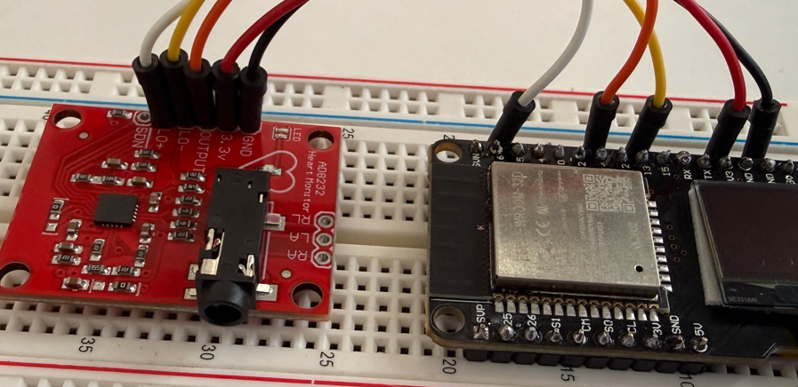
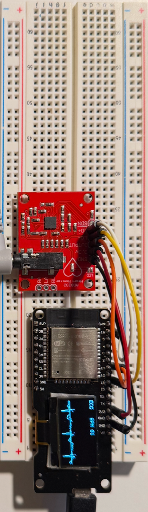

# ESP32 + AD8232 ECG Monitor

## Project summary

An educational ECG monitor built with an ESP32 HW-724 board and an AD8232
single-lead ECG breakout. The built-in OLED displays a scrolling filtered
waveform and an estimated heart rate in BPM.

The current setup produces a visibly cleaner waveform and heart-rate readings
close to an Apple Watch reference in repeated informal comparisons. This is an
experimental project, not a medical or diagnostic device.

## Hardware and setup

- ESP32 HW-724 with ESP-WROOM-32 module and built-in SSD1306 128 x 64 OLED.
- AD8232 ECG breakout, three-electrode cable, and adhesive pads.
- Breadboard and jumper wires.
- Standalone battery supply, such as a USB power bank that is not charging.

### Power precautions

Disconnect body electrodes before programming, rewiring, or connecting USB to a
computer. During body-connected testing, use standalone battery power, with the
power bank disconnected from its charger. Do not connect the body-worn circuit
to a mains-referenced computer, wall charger, oscilloscope, or other test
equipment. Software filtering does not provide electrical isolation.

### Wiring

Disconnect power before moving wires. Follow the breakout's printed labels.

| AD8232 connection | ESP32 connection | Purpose |
| --- | --- | --- |
| 3.3V | 3V3 | Sensor supply; do not use 5V |
| GND | GND | Common ground |
| OUTPUT | GPIO14 | Analog ECG input |
| LO+ | GPIO16 | Positive lead-off input |
| LO- | GPIO13 | Negative lead-off input |
| SDN | No external connection added | Retain the breakout's supplied configuration |

GPIO4 is reserved for the built-in OLED clock; use GPIO13 for LO-.

| Built-in OLED setting | Value |
| --- | --- |
| Controller / size | SSD1306 / 128 x 64 |
| SDA | GPIO5 |
| SCL | GPIO4 |
| I2C address | 0x3C |
| Separate reset pin | None configured (-1) |

GPIO14 uses ADC2 on this ESP32. Keep WiFi disabled with this wiring. Before
adding WiFi, move the analog input to a suitable available ADC1 pin and update
both the code and wiring.

### Arduino IDE

1. Install **esp32 by Espressif Systems** using Boards Manager.
2. Select **Tools > Board > esp32 > ESP32 Dev Module** and the board's COM port.
3. Install **Adafruit GFX Library** and **Adafruit SSD1306** using Library
   Manager, accepting their dependencies.
4. Open `esp32_ecg.ino` with `EcgProcessing.h` in the same sketch directory.
5. Disconnect body electrodes, then verify and upload.
6. Disconnect the computer and use standalone battery power for measurement.

**EN** resets the board. If uploading stalls at "Connecting...", hold **BOOT**
until uploading starts, then release it.

### Electrodes and operation

Follow the cable's RA, LA, and RL labels rather than assuming wire colors.

| Lead | Placement used for this project |
| --- | --- |
| RA | Below the right collarbone |
| LA | Below the left collarbone |
| RL | Lower right abdomen, reference electrode |

Use fresh pads on clean, dry skin. Fully insert the cable into the AD8232 jack,
secure the snaps, keep cables still, and relax muscles during measurement.

The OLED displays a scrolling **ECG** trace and estimated **BPM**, with `--`
before an estimate is available. **CHECK ELECTRODES** indicates a lead-off
input is HIGH. **SETTLING...** indicates the two-second recovery interval after
connection. Repeated lead-off events reset processing and restart settling.
Both lead-off inputs LOW means no disconnect is asserted; it does not establish
signal quality.

### Setup images

Close-up of the actual breadboard assembly:



Generated illustration based on the photo:


[Earlier illustration](breadboard-illustration.png)

The illustration is a visual reference. Generated pin labels and connection
details may differ from the hardware; use the wiring table and physical board
labels when connecting components.

### Sample output

The original assembly photo shows the OLED displaying the ECG waveform and a
heart-rate estimate of **81 BPM**.



## Software summary

| File | Purpose |
| --- | --- |
| `esp32_ecg.ino` | ADC sampling, connection state, OLED task, and serial output |
| `EcgProcessing.h` | Digital filters and experimental beat detector |
| `tests/processing_test.cpp` | Synthetic signal regression checks |

- Targets **250 samples/second** with a 12-bit ADC. Sampling uses a software
  schedule and skips missed deadlines after a stall.
- Removes slow baseline drift, applies a mains notch (Q = 15), and smooths the
  waveform with a 25 Hz second-order low-pass filter.
- `MAINS_HZ` defaults to **60**; set it to **50** for a 50 Hz environment.
- Detects peaks using slope energy averaged over 100 ms and an adaptive
  signal/noise threshold, with a two-second initial learning period.
- Requires at least 300 ms between detections. Intervals up to 1,500 ms
  contribute to BPM; a gap over two seconds clears the estimate.
- Smooths BPM using 75% of the previous estimate and 25% of the new estimate.
- Updates the OLED in a separate FreeRTOS task. Every fourth sample enters the
  display buffer, giving approximately **2.05 seconds** across the screen.

The waveform uses a fixed scale of 40 ADC counts per pixel and is not calibrated
in millivolts. Filtering and display decimation change waveform detail. The
interval gates correspond roughly to 40-200 BPM, but this is not a validated
measurement range.

Serial output runs at **115200 baud**:

```text
ECG:<filtered ADC counts>,BPM:<estimate>,Peak:<0 or 300>,LeadsOff:<0 or 1>
```

`Peak` marks a detector event, not an independently verified heartbeat. Serial
output is skipped when the transmit buffer lacks room. Ordinary USB bench
checks should be performed with body electrodes disconnected.

## Observations and limitations

- The working assembly displays a visibly cleaner ECG trace on the OLED.
- During a test around **80 BPM**, the displayed rate appeared close to the
  Apple Watch reading.
- Across several repeated comparisons, the user observed differences within
  approximately **2-3 BPM** relative to the Apple Watch.
- These informal observations support heart-rate agreement under the tested
  conditions. The number and duration of trials and paired readings were not
  recorded, so they do not establish a quantified accuracy specification.
- Agreement in BPM does not validate ECG waveform accuracy, rhythm
  interpretation, or medical reliability. No validated human ECG dataset has
  been used.
- Motion, muscle activity, poor electrode contact, mains interference, missed
  peaks, and extra detections can affect the waveform and BPM estimate.
- A brief ADC spike spike can suppress beat detection for the rest of a run. A synthetic 60 BPM reads as 60 BPM normally, but adding 2 full-scale ADC samples 200ms after startup produced zero detected beats.

For repeatable follow-up measurements, record simultaneous readings over steady
30-60 second intervals, along with electrode placement, activity, and signal
stability. Keep jumper and electrode wires secure and away from chargers and
power cables. If lead-off flickering occurs, check pads, snaps, the cable jack,
battery supply, common ground, and connections.

## Build and software checks

With the required board package and libraries installed:

```powershell
arduino-cli compile --fqbn esp32:esp32:esp32 .
```

Run the host regression checks from the sketch directory:

```powershell
g++ -std=c++11 tests/processing_test.cpp -o tests/processing_test.exe
.\tests\processing_test.exe
```

The synthetic tests cover 60, 90, 120, and 180 BPM in both polarities with
added mains, high-frequency, and baseline noise, plus a mains-noise-only case.
Synthetic checks assess the processing code; they do not validate hardware or
human ECG accuracy.

## Reference

The OLED mapping follows the community
[LOLIN ESP32 OLED bootstrap project](https://github.com/pjpmarques/LOLIN-ESP32-OLED).


